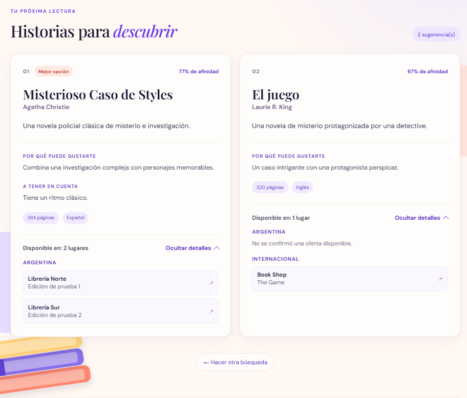

# 📚 Book Agent

## Cómo es la aplicación

### Búsqueda de recomendaciones

### Recomendaciones y opciones de compra

## CODIGO: guía general del proyecto

Este archivo es un índice general de los archivos Python propios del proyecto. Resume la responsabilidad de cada archivo; la explicación detallada de su lógica se incorpora en el propio `.py`.

El inventario incluye `main.py` y `app/`. No incluye `.venv/`, `node_modules/` ni otros archivos generados o pertenecientes a dependencias externas.

### Explicación general

La aplicación recibe una descripción de lo que una persona quiere leer y preferencias opcionales —por ejemplo, géneros, idioma, tipo de obra y extensión—. El backend usa esos datos para buscar candidatos, evaluarlos y ordenarlos, y después intenta localizar ediciones y ofertas comerciales. El frontend presenta las recomendaciones y el estado de esas búsquedas.

#### Recorrido principal

1. La interfaz React envía el texto y las preferencias a la API de FastAPI.
2. La API valida la solicitud, crea el estado inicial y ejecuta el grafo de LangGraph.
3. El grafo interpreta el pedido, prepara filtros, descubre libros y resuelve la identidad de las obras.
4. Los candidatos se evalúan y ordenan; luego se verifica la información de idioma y se investiga cada libro.
5. Se redactan las recomendaciones y se buscan ediciones y opciones de compra.
6. La API devuelve los datos como JSON y el frontend muestra las recomendaciones, su afinidad, las razones y los enlaces comerciales que hayan sido validados.

El modelo de lenguaje ayuda a interpretar, evaluar y redactar. Los datos de catálogo y disponibilidad dependen de servicios externos, por lo que puede haber recomendaciones sin una oferta de compra confirmada.

#### Modelos de IA y variabilidad de resultados

El proyecto permite usar modelos de chat de **Groq** o **OpenAI**. De forma predeterminada, Groq usa `openai/gpt-oss-120b` para las tareas generales y `qwen/qwen3.8-27b` para resolver la identidad de las obras; OpenAI usa `gpt-5.4-mini` para ambas. El proveedor y los modelos pueden configurarse mediante variables de entorno. La razón por la cual se utilizó Groq fue para testeos iniciales y por un tema de costos.

Para generar embeddings y recuperar investigaciones semánticamente similares desde Chroma, el proyecto usa **Hugging Face** con `sentence-transformers/paraphrase-multilingual-MiniLM-L12-v2`. Este modelo de embeddings apoya la búsqueda; no es el modelo de chat que redacta las recomendaciones.

Los resultados no son fijos: dependen del proveedor y del modelo de chat configurados, y pueden variar en la interpretación de las preferencias, la evaluación y el texto de las recomendaciones. El modelo de embeddings también influye en qué información semánticamente relacionada se recupera. Por eso, cambiar de modelo puede producir resultados distintos; además, influyen los datos disponibles y las respuestas de los servicios externos.

### Archivos Python de la aplicación

#### Entrada y API

- **`main.py`:** CLI opcional para ejecutar el grafo localmente. Acepta el pedido como argumento o de forma interactiva, imprime recomendaciones y estados de búsqueda, y solo guarda el informe si se indica `--output`.
- **`app/api.py`:** define la API FastAPI, valida los pedidos, ejecuta el grafo, devuelve recomendaciones y sirve el frontend compilado cuando está disponible.
- **`app/config.py`:** carga variables de entorno desde `.env` y centraliza las claves de Groq, OpenAI, Exa y Tavily.

#### Grafo y flujo de trabajo

- **`app/graph/state.py`:** define el estado compartido por los nodos y la función que construye el estado inicial de una solicitud.
- **`app/graph/graph.py`:** registra los nodos, establece su secuencia y compila el grafo que ejecuta la API.
- **`app/llm.py`:** selecciona Groq u OpenAI según las claves configuradas, crea los modelos y aplica reintentos genéricos ante límites de uso.
- **`app/graph/nodes.py`:** contiene las etapas principales: interpretar preferencias, preparar filtros, buscar y evaluar libros, ordenar candidatos, investigar y redactar recomendaciones, usando el proveedor configurado.
- **`app/graph/edition_nodes.py`:** completa las recomendaciones con ediciones de catálogo y opciones de compra validadas.

#### Modelos de datos

- **`app/models/reader.py`:** define las preferencias explícitas y el contexto de lectura extraído del mensaje.
- **`app/models/book.py`:** reúne los modelos de candidatos, filtros, evaluaciones, investigaciones, recomendaciones, ediciones y estados de búsqueda comercial.
- **`app/models/work_identity.py`:** define los datos para agrupar candidatos que representan la misma obra y normaliza algunas respuestas del modelo de lenguaje.

#### Herramientas y servicios externos

- **`app/tools/book_search.py`:** consulta Open Library y convierte sus resultados de obras y ediciones en datos utilizables por el grafo.
- **`app/tools/book_vector_store.py`:** guarda y recupera investigaciones de libros en Chroma para reutilizar información y reducir consultas repetidas.
- **`app/tools/edition_search.py`:** coordina la búsqueda en librerías, prepara consultas y valida coincidencia del libro, URL y evidencia de disponibilidad.
- **`app/tools/exa_search.py`:** adapta el cliente de Exa a la interfaz de búsqueda que usa la disponibilidad comercial.
- **`app/tools/tavily_search.py`:** adapta las respuestas de Tavily a esa misma interfaz, para poder usar ambos proveedores.
- **`app/tools/web_research.py`:** busca información editorial y crítica sobre libros en fuentes web; esta ruta independiente sigue usando Tavily.
- **`app/tools/recommendation_formatter.py`:** convierte las recomendaciones y sus datos de catálogo y compra en texto legible para la salida de consola.

#### MCP

- **`app/mcp/client.py`:** inicia la comunicación con el servidor MCP, reenvía las credenciales configuradas para Mercado Libre, Exa y Tavily, llama a la herramienta y normaliza su respuesta.
- **`app/mcp/availability_server.py`:** publica la herramienta MCP de disponibilidad comercial. Elige Exa cuando `EXA_API_KEY` está configurada; si no, usa Tavily cuando encuentra `TAVILY_API_KEY`.
